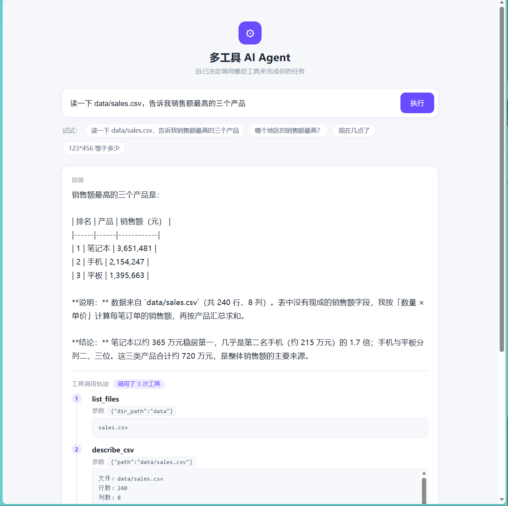

# 多工具 AI Agent（Multi-Tool AI Agent）

一个**能自己调用工具干活**的 AI Agent：给它一个任务，它自己决定**调用哪些工具、按什么顺序调**，最后给出结论，并把**完整的工具调用轨迹**回显出来。

典型任务：

> 「读一下 `data/sales.csv`，告诉我销售额最高的三个产品」

Agent 会自己完成：找文件 → 看数据结构 → 分组聚合 → 给出结论。

---

## 1. 核心功能

- **自主决策**：模型根据「工具清单」自己决定调不调工具、调哪个、调几次（闲聊不调，需要数据才调）
- **多工具编排**：一次提问可连续调用多个工具（如 找文件 → 看结构 → 统计）
- **本地数据分析**：在本地对 CSV / Excel 做结构探查与分组聚合，**明细数据不出本机**
- **调用轨迹回显**：返回 `trace`，前端按时间线展示每一步，过程可审计
- **默认安全**：默认只挂「受限分析工具」；高危工具默认关闭，需显式开启，且运行在独立子进程中
- **容错健壮**：工具报错不会拖垮服务（错误作为结果喂回模型，模型可自行纠正重试）；超时强制终止；格式异常自动纠正

## 2. 技术栈

| 层 | 技术 |
|---|---|
| 后端 | Python · FastAPI · Uvicorn |
| 模型 | DeepSeek `deepseek-chat`（OpenAI 兼容接口，Function Calling） |
| 数据处理 | pandas · numpy · openpyxl |
| 安全 | 路径白名单 · 表达式白名单 · 子进程隔离 · 精简环境变量 · 输出截断 |
| 前端 | HTML · CSS · 原生 JS（`fetch`） |

## 3. 系统架构

```
浏览器（static/index.html）
     │  POST /agent  {"question": "..."}
     ▼
FastAPI（main.py）
     │  进入 Agent 主循环 run_agent()
     ▼
┌──────────────────────────────────────────────┐
│  ① 带上「工具清单(TOOLS_SCHEMA)」+ 用户问题    │
│     请求 DeepSeek                             │
│  ② 模型回复：                                  │
│     ├─ tool_calls 为空 → 直接答，结束          │
│     └─ tool_calls 非空 → 逐个执行工具           │
│  ③ 工具执行（try/except 兜底，错误也喂回模型）  │
│  ④ 结果以 role="tool" 消息喂回模型             │
│  ⑤ 回到 ②，最多 MAX_STEPS 轮（默认 15）        │
└──────────────────────────────────────────────┘
     │  返回 {answer, trace, steps}
     ▼
前端：答案 + 工具调用轨迹时间线
```

## 4. 项目目录

```
multi-tool-ai-agent/
├── main.py                       # FastAPI + Agent 主循环 + 工具注册
├── tools.py                      # 工具实现（含安全检查与子进程隔离）
├── prompts/
│   └── finance_agent.md          # 财务勾稽模式的系统提示词（改文本即可，不动代码）
├── data/
│   ├── sales.csv                 # 示例销售数据（240 行，合成数据）
│   ├── hard/
│   │   ├── orders_dirty.csv      # 脏数据示例（270 行：重复/缺失/千分位文本/空格/混格式）
│   │   └── products.csv          # 产品 → 类别/品牌 关联表（做类别统计需 join）
│   ├── fin/
│   │   ├── sample_fin.xlsx       # 财务三表示例（内含 12 处注入缺陷）
│   │   ├── sample_fin_baked.xlsx # 同上，经 Excel 重算保存（缓存值可用）
│   │   └── ground_truth.json     # 上述缺陷的标准答案
│   └── tesla/
│       ├── tesla_financials.csv  # 特斯拉 2014–2024 财务宽表（官方 SEC EDGAR 数据）
│       ├── sec_raw_facts.csv     # 原始取数痕迹（66 条）
│       └── README.md             # 数据来源与口径说明
├── static/
│   └── index.html                # 前端页面（含工具调用轨迹展示）
├── eval/                         # 评测集与指标（见 §12.2）
│   ├── eval_set.json             # 主评测集（28 条）
│   ├── hard_set.json             # 难度探针（12 条脏数据任务）
│   ├── tesla_set.json            # 真实财报集（10 条）
│   ├── gen_eval_set.py           # 生成主评测集（标准答案由 pandas 现算）
│   ├── gen_hard_set.py           # 生成难度探针（含脏数据注入）
│   ├── run_eval.py               # 真实跑批（调 run_agent，落盘轨迹与完整回答）
│   ├── summarize.py              # 算指标（只读结果文件，不调 API）
│   ├── scoring.py                # 判分规则（集中一处，可离线重新判分）
│   ├── check_ui.py               # 前端静态检查（配色/对比度/结构/JS 引用完整性）
│   ├── metrics_*.md              # 指标汇总表
│   └── results_*.json            # 原始结果（含每条轨迹，可逐题复查）
├── tests/
│   └── check_sandbox.py          # 子进程隔离与安全拦截的验证脚本
├── generate_sample_data.py       # 合成数据生成脚本（固定随机种子，可复现）
├── fetch_tesla_sec.py            # 从 SEC EDGAR 抓取财报（可重复再生）
├── make_fin_sample.py            # 生成财务三表示例（含缺陷注入）
├── run.bat                       # Windows 一键启动
├── requirements.txt
├── .env.example
└── README.md
```

> `sandbox/` 是 `run_python` 子进程的工作目录，运行时自动生成，已加入 `.gitignore`。

## 5. 安装

环境要求：**Python 3.10+**

```powershell
git clone https://github.com/angzhengyu/multi-tool-ai-agent.git
cd multi-tool-ai-agent

python -m venv .venv
.\.venv\Scripts\Activate.ps1
pip install -r requirements.txt
```

装完确认依赖就绪：

```powershell
python -c "import pandas, openpyxl, fastapi; print('依赖就绪')"
```

> **请始终用同一个虚拟环境安装并启动。** Agent 执行 `run_python` 时是**以当前解释器**启动子进程的，
> 如果换用一个没装 pandas 的 Python 启动，服务本身能跑，但数据类工具会报 `ModuleNotFoundError`。

### 一键启动（Windows）

```powershell
.\run.bat
```

`run.bat` 会**逐个验证候选解释器是否真的装了 pandas / openpyxl**，选中第一个可用的再启动，避免出现「服务能开、工具全废」的情况。想指定自己的解释器：

```powershell
set PY_AGENT=C:\path\to\python.exe
run.bat
```

## 6. 配置

复制 `.env.example` 为 `.env` 并填写：

```
DEEPSEEK_API_KEY=sk-你的密钥

# 可选：开启高危工具 run_python（默认关闭）
# ENABLE_RUN_PYTHON=1

# 可选：切换为财务勾稽模式（默认 csv）
# AGENT_MODE=finance

# 可选：覆盖最大工具调用轮数（默认 15）
# MAX_STEPS=15
```

## 7. 启动

```powershell
python main.py          # 端口 8001
```

- 网页：http://127.0.0.1:8001
- 接口文档：http://127.0.0.1:8001/docs
- 需要高危工具时：`$env:ENABLE_RUN_PYTHON='1'; python main.py`

## 8. API 说明

| 接口 | 方法 | 说明 |
|---|---|---|
| `/` | GET | 前端页面 |
| `/agent` | POST | 执行任务。请求 `{"question": "..."}`；返回 `{answer, trace, steps}` |
| `/health` | GET | 健康检查：当前模式、已挂载工具、轮数上限 |
| `/assets` | GET | 数据资产清单（`data/` 下的文件、大小、行数） |

`POST /agent` 响应示例：

```json
{
  "answer": "销售额最高的三个产品是：1) 笔记本 3,651,481  2) 手机 2,154,247  3) 平板 1,395,663",
  "steps": 3,
  "trace": [
    {"tool": "list_files", "arguments": {"dir_path": "data"}, "result": "sales.csv"},
    {"tool": "describe_csv", "arguments": {"path": "data/sales.csv"}, "result": "行数：240 ..."},
    {"tool": "aggregate_csv",
     "arguments": {"path": "data/sales.csv", "group_by": "产品", "value_expr": "数量*单价", "agg": "sum", "top_n": 3},
     "result": "按「产品」分组统计（数量*单价 的 sum），前 3 名：\n  笔记本\t3651481\n  手机\t2154247\n  平板\t1395663"}
  ]
}
```

## 9. Demo 截图



> 截图展示：输入任务 → 得到回答 + **工具调用轨迹时间线**（`list_files` → `describe_csv` → `aggregate_csv`）

## 10. 工具清单

| 工具 | 能力 | 安全级别 |
|---|---|---|
| `get_current_time` | 取当前时间 | 只读 |
| `calculate` | 数学表达式计算 | **字符白名单**（只允许数字与 `+ - * / ( ) . %`） |
| `list_files` | 列出目录（限项目内） | 路径白名单 |
| `describe_csv` | CSV 结构探查（列名/类型/缺失/统计） | 路径白名单，**不返回明细行** |
| `aggregate_csv` | 分组聚合（分组/求和/平均/计数/排序取前 N） | 路径白名单 + **算式白名单**，**只返回聚合结果** |
| `read_excel` | 读 Excel 结构 + 双通道内容（公式文本 / 缓存值 / 缓存缺失统计 / 合并单元格 / 单位线索） | 路径白名单，**只读、不返回批量明细**；常开，不需要 `ENABLE_RUN_PYTHON` |
| `run_python` | 执行 Python 代码（可用 pandas / numpy） | ⚠️ **默认关闭**；开启后在独立子进程中运行 |

> `aggregate_csv` 的 `value_expr` 支持简单算式（如 `数量*单价`），但只允许「**列名 + 数字 + 运算符 + 括号**」，
> 用列名白名单校验后执行 —— 既能算派生指标，又不会被注入。

### 10.1 两种模式：CSV 分析 / 财务勾稽

通过 `AGENT_MODE` 切换系统提示词，**工具集不变**：

| | CSV 模式（默认） | 财务勾稽模式 |
|---|---|---|
| 系统提示词 | 内联（CSV 分析流程） | `prompts/finance_agent.md`（改文本即可，不动代码） |
| 定位 | 表格数据分析 | 三表**勾稽校验** C01–C12 + 三态结论 + 问题清单 |
| 硬边界 | — | **禁止审计/投资定性判断**；未通过统一表述为「未通过勾稽校验，建议人工复核」 |

### 10.2 为什么财务场景需要 `read_excel` 这个专工具

1. **省轮次**：让模型用 `run_python` 手写 openpyxl 读一张表要二十几行、还得写两遍（公式通道 + 缓存通道），
   实测吃掉 2~3 轮配额；换成专工具后，整个勾稽任务只需 **3 次工具调用**。
2. **避免平台错误**：模型自行回忆 openpyxl 用法时，会写出 Unix 风格绝对路径（如 `/home/user/...`），
   在 Windows 上不存在，白白浪费一轮。
3. **最关键的一点**：**「缓存值是否存在」必须由工具明确告知**。
   由程序生成、从未被 Excel 打开保存过的 `.xlsx`，缓存值通道会**整片为 `None`**；
   模型若把 `None` 当 0 继续算，整份报告就废了。`read_excel` 会直接统计并告警：

   ```
   缓存值/通道B：12 个公式格中 **12 个缺失、0 个有值**
   ⚠️ 该表通道 B **完全不可用**（文件由程序生成、从未被 Excel 保存过）。
   ```

> 这**没有放宽任何安全设置**：`read_excel` 只读项目内文件、不返回批量明细，与 `describe_csv` 同级常开。
> **「让模型写任意代码」从来不是唯一解，「给它一个受限的专用工具」才是。**

## 11. 安全说明

### 11.1 为什么要默认关闭 `run_python`

让模型执行任意代码，会同时打开三个风险口子：

1. **越界读文件** —— 代码可以遍历磁盘，读到项目目录之外的表格；
2. **擅自改动运行环境** —— 代码可以 `pip install`，改变运行环境；
3. **隐私数据出域** —— 工具结果会回传给大模型，读到什么就等于把什么发出去。

因此本项目的做法不是「因为危险就不用」，而是**默认安全、能力够用、边界可验证**。

### 11.2 具体措施

**（1）默认只挂「受限分析原语」** —— 把「任意代码」换成「够用的固定能力」
- `describe_csv`：只返回结构统计，**不返回明细行**
- `aggregate_csv`：本地完成分组聚合，**只把聚合结果交给模型**
- 效果：**数据在本机算，结论才上云**

**（2）高危工具默认关闭**
- `run_python` 需显式设置 `ENABLE_RUN_PYTHON=1` 才挂载

**（3）开启后仍做纵深防御**

| 防线 | 做法 |
|---|---|
| 危险模式拦截 | 禁 `subprocess` / `pip install` / 删文件 / 网络库 |
| 路径白名单 | 代码里的绝对路径必须在项目目录内 |
| **子进程隔离** | 独立进程执行，崩溃或死循环不影响主服务，**30 秒超时强制终止** |
| **精简环境变量** | 子进程只保留 `PATH / PYTHONIOENCODING / PYTHONUTF8 / SYSTEMROOT / TEMP / TMP`，**拿不到任何 API key** |
| **输出截断** | 最多回传 4000 字符，避免海量明细灌回模型 |

**（4）出域前不过明细**
- 所有工具的返回都坚持「**结构 + 聚合**」，不返回原始数据行

### 11.3 验证

```powershell
python tests/check_sandbox.py
```

预期输出（注意子进程的环境变量列表里**不含任何 API key**）：

```
=== 检查 run_python 的子进程环境变量 ===
['PATH', 'PYTHONIOENCODING', 'PYTHONUTF8', 'SYSTEMROOT', 'TEMP', 'TMP']

✅ 通过：子进程拿不到 API key，沙箱生效。

=== 顺带检查 _guard 能否拦住危险代码 ===
  ✅ 装包：拒绝执行：代码里出现了被禁止的用法「subprocess」（本项目只允许在 data/ 目录内做数据分析）。
  ✅ 访问项目外路径：拒绝执行：不允许访问项目目录之外的路径「C:\Windows\win.ini」。请改用 DATA_DIR（它只指向本项目的 data/ 目录）。
  ✅ 删文件：拒绝执行：代码里出现了被禁止的用法「shutil.rmtree」（本项目只允许在 data/ 目录内做数据分析）。
```

### 11.4 局限（请务必知悉）

- 这套机制**不是真正的沙箱**：Windows 上无法做只读挂载与禁网，黑名单理论上可被绕过；
- **生产环境应使用容器 / gVisor 等做进程级隔离**（只读文件系统、禁网、资源限额）；
- 只要工具结果会回传模型，就存在**数据出域**风险 —— **不要用本工具处理隐私数据**（学生名册、身份证、医疗记录等），除非已脱敏。

## 12. 测试

### 12.1 功能自测

- 闲聊（如「你好」）→ 不应调用任何工具（`steps: 0`）
- 数据分析（如「哪个地区销售额最高？」）→ 应调用 `describe_csv` + `aggregate_csv`
- 越权请求（如让它读项目外的文件）→ 应被拒绝并给出安全替代方案

```powershell
python tests/check_sandbox.py       # 验证子进程隔离与安全拦截
python eval/check_ui.py             # 验证前端页面（配色/对比度/结构/引用完整性）
```

### 12.2 评测结果

```powershell
# 生成评测集（标准答案由 pandas 现算，不调 API）
python eval/gen_eval_set.py     # 主评测集（28 条）
python eval/gen_hard_set.py     # 难度探针（12 条脏数据任务）

# 真实跑批（会真调 DeepSeek，每套约 1~2 分钟）
# CE_SET 会按 tag 前缀自动推断：hard_* → hard_set.json，tesla_* → tesla_set.json，其余 → eval_set.json
$env:CE_TAG='run_v3';   python eval/run_eval.py
$env:CE_TAG='hard_v3';  python eval/run_eval.py
$env:CE_TAG='tesla_v3'; python eval/run_eval.py

# 算指标（只读结果文件，不调 API，可反复重算）
$env:CE_TAG='run_v3'; python eval/summarize.py
# 不带 CE_TAG 运行，会列出当前可用的 tag
python eval/summarize.py
```

三套评测集的分工：主评测集（干净数据）验「功能对不对」；难度探针（脏数据）验「边界顶不顶得住」；真实财报（官方 SEC 一手数据）验「换成真实业务表还灵不灵」。

| | 主评测集 `eval_set.json` | 难度探针 `hard_set.json` | 真实财报 `tesla_set.json` |
|---|---|---|---|
| 数据 | `data/sales.csv`（240 行，干净） | `data/hard/orders_dirty.csv`（270 行，故意弄脏） | `data/tesla/tesla_financials.csv`（**官方 SEC EDGAR XBRL**，2014–2024） |
| 条数 | 28（单步 10 · 多步 12 · 容错 3 · 越权 3） | 12（重复/缺失/千分位文本/空格/混格式/跨文件关联） | 10（含 1 条「数据里没有这一年」的边界题） |
| **任务完成率** | **100.0%（28/28）** | **91.7%（11/12）** | **100.0%（10/10）** |
| 工具调用成功率 | 97.9%（47/48） | 97.2%（35/36） | 100.0%（58/58） |
| 平均完成轮数 | 2.50 | 3.33 | 4.60 |

> 指标文件：`eval/metrics_run_v3.md`、`eval/metrics_hard_v3.md`、`eval/metrics_tesla_v3.md`；
> 原始轨迹（可逐题复查）：`eval/results_run_v3.json`、`eval/results_hard_v3.json`、`eval/results_tesla_v3.json`。

**判分口径**：答案需包含全部期望数字（容差 0.5%）与期望关键词，且不含禁止串。
`tesla_set.json` 的各题额外声明了 `require_tools`，要求答案**必须来自本地文件**，凭模型记忆作答不计通过。

**方法学提示**：干净数据上的高分区分度有限，应结合难度探针一起看；判分是「必要不充分」，
只校验期望数字与关键词是否出现，不能保证答案没有其他编造内容；单次运行存在模型随机性
（temperature 未固定），1~2 条的差异不宜当作结论。

## 13. 已知限制

- **`describe_csv` 会掩盖脏数据**：它先用 `to_numeric(errors="coerce")` 清洗再报统计，
  并把 `object` 列也标成「数值列」，容易让人误以为可以直接算。
- **`aggregate_csv` 会静默截断 `top_n`**：请求 270 名只会返回前 50，且不提示已截断。
- **每次请求无状态**：不支持多轮会话与上下文延续。
- **超时兜底分支的输出未做格式清洗**：达到 `MAX_STEPS` 后的兜底回答可能残留内部标记。

## 14. 后续计划

- [ ] 更完善的隔离方案（容器 / gVisor）
- [ ] 出域前自动脱敏（姓名、学号、手机号等 PII 掩码）
- [ ] Human-in-the-loop：高危操作需人工确认
- [ ] 更多工具：SQL 查询、绘图、报告生成
- [ ] 多轮会话 / 上下文管理
- [ ] 把评测判分纳入 CI（GitHub Actions），防止改代码改坏指标
- [ ] Docker 化部署

---

## 数据声明

- `data/sales.csv`、`data/hard/*.csv`、`data/fin/*.xlsx` 均为**脚本生成的合成数据**
  （固定随机种子，可复现），**不含任何真实个人或业务信息**；
- `data/tesla/*` 来自 **SEC EDGAR 公开财报**（CIK 0001318605），由 `fetch_tesla_sec.py` 抓取，可重复再生，
  口径说明见 `data/tesla/README.md`。

*本仓库用于展示 Function Calling / 多工具 Agent / 数据安全的工程实践。*
